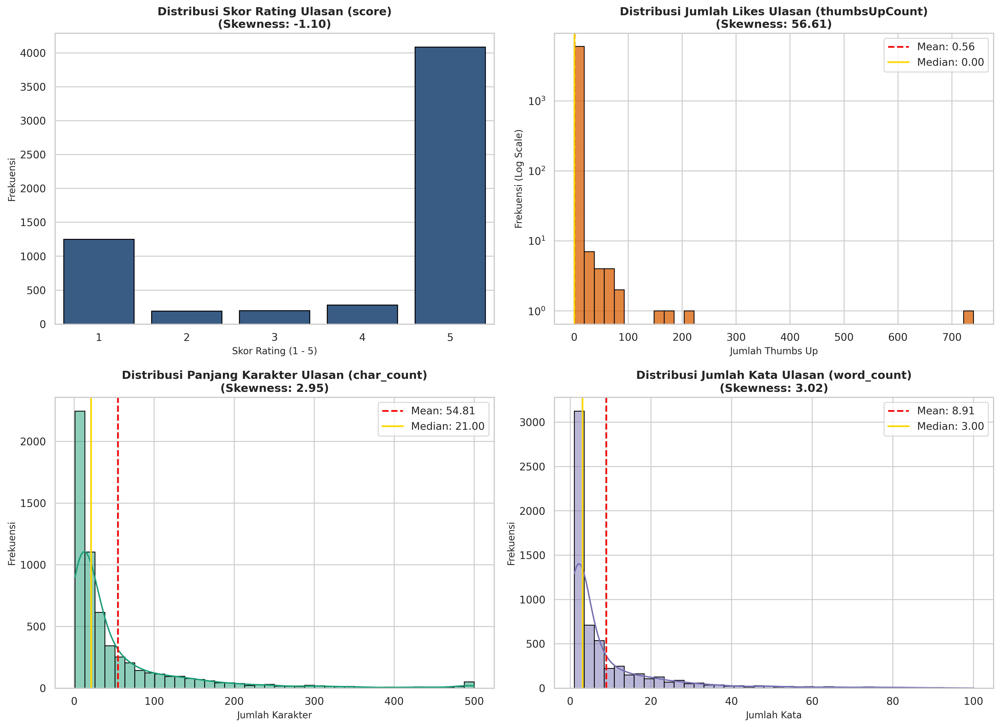
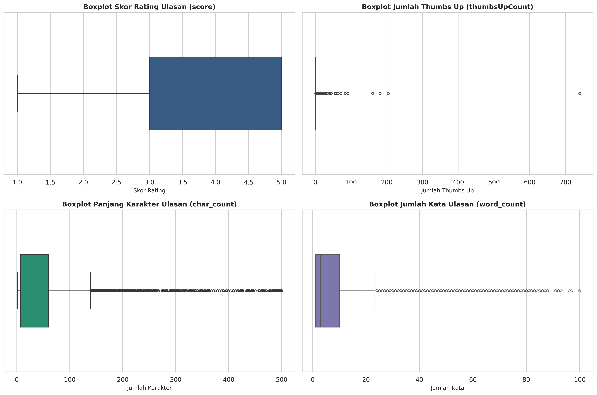
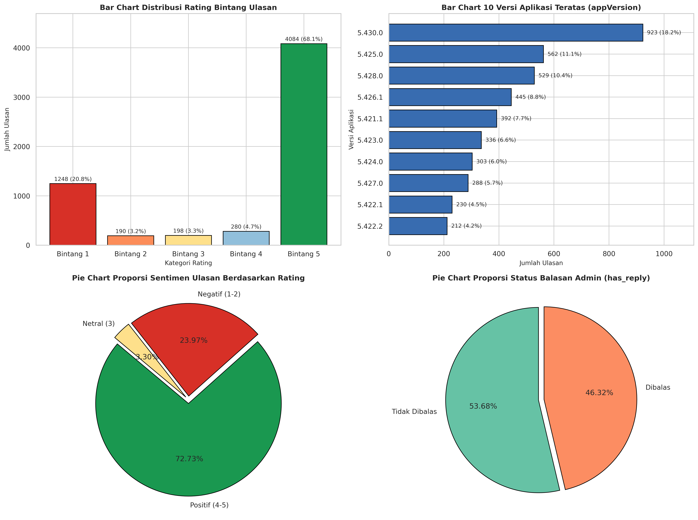
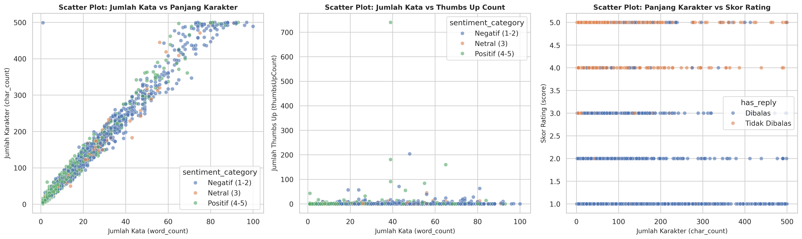
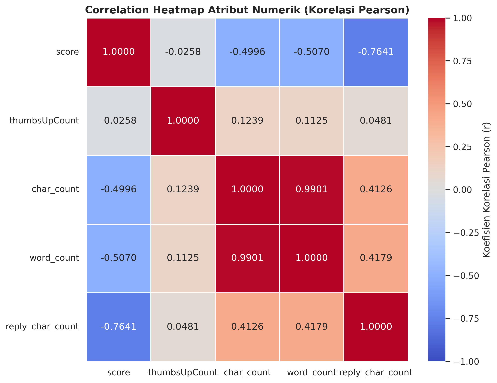

# Grab Indonesia Google Play Store Reviews — Data Description & Visualization


End-to-end exploratory data analysis (EDA), data quality auditing, feature transformation, descriptive statistics, and statistical visualization on **6,000 Google Play Store user reviews** of the **Grab Indonesia** application (`com.grabtaxi.passenger`), crawled via Google Colab.

---

## Project Metadata

| Field | Details |
| :--- | :--- |
| **Course** | Rekayasa Data (*Data Engineering*) — Tugas 2: Praktikum Python |
| **Topic** | Deskripsi Data dan Visualisasi Data (*Data Description & Data Visualization*) |
| **Authors** | **Ryan Subitha Maliq Rasheed** ([@ryan0556](https://github.com/ryan0556)) & **Daffa Julian Idrus** |
| **Program & Institution** | S1 Sistem Informasi, Fakultas Teknologi Informasi, Universitas Budi Luhur |
| **Data Source** | Google Play Store Reviews (`com.grabtaxi.passenger`, Region: Indonesia `id`) via Google Colab |
| **Dataset Volume** | 6,000 records × 11 raw attributes (19 attributes post-transformation) |

---

## Repository Structure

```text
grab-playstore-reviews-eda/
├── README.md                                           # Project documentation & key findings
├── requirements.txt                                    # Python package dependencies
├── .gitignore                                          # Git ignore rules for Python/Jupyter
├── LICENSE                                             # MIT License
├── Tugas1_DW.csv                                       # Raw crawled Google Play Store dataset (6,000 rows)
├── Tugas2_Deskripsi_dan_Visualisasi_Data.ipynb         # Main Google Colab / Jupyter Notebook
├── src/
│   └── tugas2_analysis.py                              # Standalone Python script version
├── figures/
│   ├── soal5_histogram_numerik.png                     # Numeric distributions (Histogram & KDE)
│   ├── soal6_boxplot_outlier.png                       # Outlier & IQR analysis (Boxplot)
│   ├── soal7_bar_pie_kategorikal.png                   # Categorical distributions (Bar & Pie charts)
│   ├── soal8_scatter_plot.png                          # Multivariate relationships (Scatter plots)
│   └── soal9_correlation_heatmap.png                   # Pearson correlation matrix heatmap
└── docs/
    ├── Laporan_Tugas2_Deskripsi_dan_Visualisasi_Data.pdf # Full academic analysis report (PDF)
    └── Grafik_Visualisasi_Tugas2.pdf                     # Combined high-resolution chart bundle (PDF)
```

---

## Dataset Schema & Data Quality Summary

The raw dataset `Tugas1_DW.csv` contains **6,000 rows** and **11 columns** crawled from the Google Play Store reviews section:

| Column | Raw Dtype | Non-Null | Missing (%) | Unique | Description |
| :--- | :--- | :---: | :---: | :---: | :--- |
| `reviewId` | `object` | 6,000 | 0.00% | 6,000 | Unique UUID primary key per review |
| `userName` | `object` | 6,000 | 0.00% | 5,947 | Display name of the Google Play user |
| `userImage` | `object` | 6,000 | 0.00% | 5,987 | Avatar image URL of the reviewer |
| `content` | `object` | 6,000 | 0.00% | 4,239 | Raw review text written by the user |
| `score` | `int64` | 6,000 | 0.00% | 5 | Star rating from `1` (lowest) to `5` (highest) |
| `thumbsUpCount` | `int64` | 6,000 | 0.00% | 39 | Number of helpful votes (*thumbs up*) received |
| `reviewCreatedVersion` | `object` | 5,068 | 15.53% | 129 | App version installed when the review was written |
| `at` | `object` | 6,000 | 0.00% | 5,998 | Timestamp when the review was posted (`datetime64`) |
| `replyContent` | `object` | 2,779 | 53.68% | 62 | Official reply text from Grab Customer Support |
| `repliedAt` | `object` | 2,779 | 53.68% | 2,751 | Timestamp when Grab Customer Support replied (`datetime64`) |
| `appVersion` | `object` | 5,068 | 15.53% | 129 | App version metadata (100% identical to `reviewCreatedVersion`) |

### Engineered Features (`df_clean`)
To support deeper statistical and correlation analysis across numeric and categorical dimensions, the pipeline extracts:
- `char_count`: Character length of `content` (`Mean = 54.81`, `Median = 21.00`, `IQR = 53.00`)
- `word_count`: Word count of `content` (`Mean = 8.91`, `Median = 3.00`, `IQR = 9.00`)
- `reply_char_count`: Character length of `replyContent` (`0` if un-replied; `Mean = 87.85`)
- `response_time_hours`: Turnaround time `(repliedAt - at)` in hours
- `has_reply`: Binary response indicator (`Dibalas` = 46.32% vs `Tidak Dibalas` = 53.68%)
- `sentiment_category`: Rating bucket (`Positif (4-5)` = 72.73%, `Negatif (1-2)` = 23.97%, `Netral (3)` = 3.30%)
- `rating_label`: Explicit star label (`Bintang 1` through `Bintang 5`)

---

## Key Analytical Findings

1. **Bimodal J-Shaped Rating Polarization**: Ratings are heavily polarized at the extremes — **68.07% (4,084 reviews)** are 5-star and **20.80% (1,248 reviews)** are 1-star, while 2-, 3-, and 4-star reviews combined account for only **11.13%**.
2. **Negative Correlation Between Rating & Review Length**: Review length correlates negatively with star rating (`r = -0.5070` for `score` vs `word_count`; `r = -0.4996` for `score` vs `char_count`). Satisfied users leave 1–4 word praise (causing 1,761 duplicate text strings like *"bagus"* or *"mantap"*), whereas dissatisfied users write detailed multi-sentence bug/service complaints (accounting for the 660 upper-tail text length outliers `> 139.5` characters).
3. **Targeted Customer Support Triaging**: `score` and `reply_char_count` exhibit a strong negative Pearson correlation (`r = -0.7641`). Grab Customer Support systematically replies to 1–2 star complaints with standardized ~228-character apology and help-center escalation templates (`https://grb.to/consumeridhelpcenter`), while most 5-star reviews go unreplied or receive a short ~73-character thank-you note.
4. **Community Validation on Detailed Complaints**: `thumbsUpCount` is highly right-skewed (`skewness = +56.61`, `91.17%` zeros, `530` outliers up to `740` likes), with high-engagement reviews clustering in the 1-star detailed complaint segment.
5. **100% Redundancy Between Version Columns**: `reviewCreatedVersion` and `appVersion` are identical across all 5,068 non-null records and co-missing on the remaining 932 records, indicating one column can be dropped during ETL into a Data Warehouse.

---

## Visualizations Preview

| Soal | Visualization Output | Preview |
| :---: | :--- | :---: |
| **Soal 5** | Numeric Distributions (`score`, `thumbsUpCount`, `char_count`, `word_count`) |  |
| **Soal 6** | Boxplot & Tukey IQR Outlier Detection |  |
| **Soal 7** | Categorical Distributions (2 Bar Charts & 2 Pie Charts) |  |
| **Soal 8** | Multivariate Scatter Plots by Sentiment & Reply Status |  |
| **Soal 9** | Pearson Correlation Matrix Heatmap (`r`) |  |

---

## Quickstart & Reproduction

### Option 1: Run on Google Colab
1. Open `Tugas2_Deskripsi_dan_Visualisasi_Data.ipynb` in Google Colab.
2. Upload `Tugas1_DW.csv` to the session working directory (`/content/Tugas1_DW.csv`).
3. Click **Runtime -> Run all** to generate all tables and export the 300-DPI PNG charts.

### Option 2: Run Locally
```bash
# 1. Clone the repository
git clone https://github.com/ryan0556/grab-playstore-reviews-eda.git
cd grab-playstore-reviews-eda

# 2. Create a virtual environment and install dependencies
python -m venv .venv
source .venv/bin/activate  # On Windows: .venv\Scripts\activate
pip install -r requirements.txt

# 3. Launch Jupyter Notebook or run the standalone Python script
jupyter notebook Tugas2_Deskripsi_dan_Visualisasi_Data.ipynb
# OR
python src/tugas2_analysis.py
```

---

## License
Distributed under the [MIT License](LICENSE). © 2026 Ryan Subitha Maliq Rasheed & Daffa Julian Idrus.
